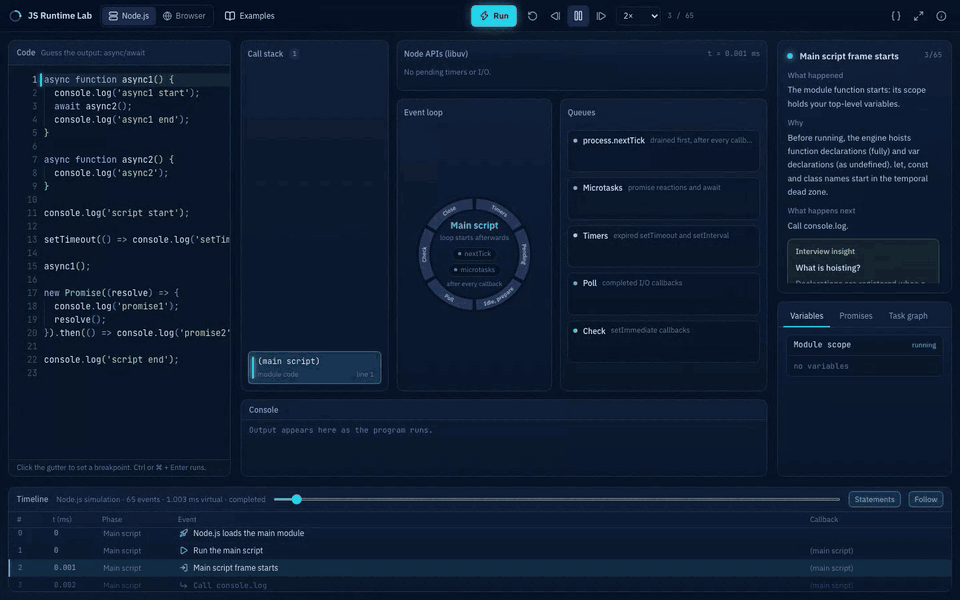
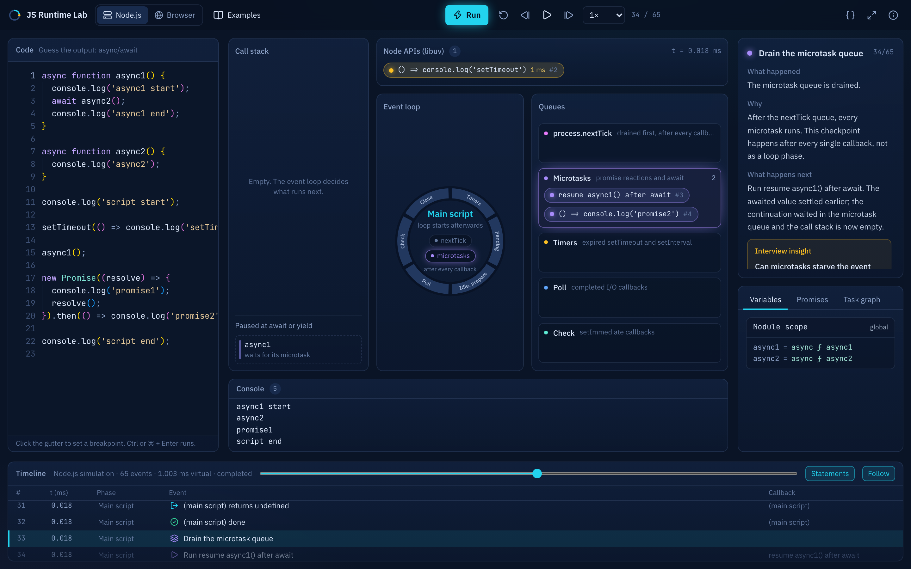
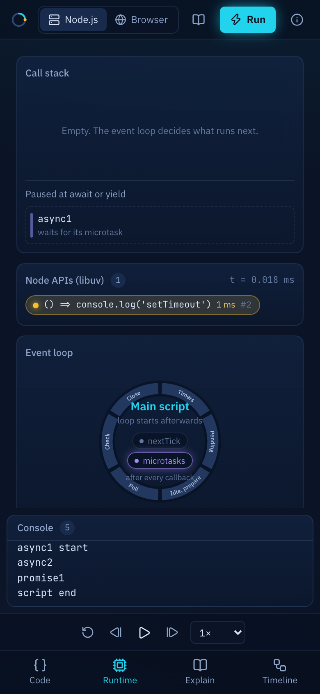

<p align="center">
  
</p>

<p align="center">
  
  
  
  
  
  
</p>

<p align="center">
  <a href="#-quick-start">Quick start</a> ·
  <a href="#-features">Features</a> ·
  <a href="#-how-it-works">How it works</a> ·
  <a href="#-example-library">Examples</a> ·
  <a href="#-security-model">Security</a> ·
  <a href="#-deploying">Deploying</a>
</p>

---

**Why does `promise2` print before `setTimeout`? Why does `nextTick` jump the queue?** Event-loop questions are hard because the event loop is invisible. JS Runtime Lab makes it visible: it really runs your code, records every call, every scheduled callback and every queue movement, then replays it like a video you can pause, rewind and step through, with a plain-English explanation of each step.

<p align="center">
  
</p>

## ✨ Features

<table>
  <tr>
    <td width="33%" valign="top">
      <h4>🔁 Two real event loops</h4>
      <b>Node.js</b> mode mirrors libuv's phases (timers → pending → idle/prepare → poll → check → close) with <code>process.nextTick</code>. <b>Browser</b> mode follows the HTML event loop: one task, a microtask checkpoint, then animation frames.
    </td>
    <td width="33%" valign="top">
      <h4>⏪ Step backward, not just forward</h4>
      Every run becomes a trace. Seek anywhere, step back and forth, set breakpoints in the gutter, or play at 0.01× to 4×. Snapshots every 25 events keep seeking instant, even on 25,000-event traces.
    </td>
    <td width="33%" valign="top">
      <h4>🧠 Explanations, not just visuals</h4>
      Each step says <i>what happened</i>, <i>why</i> and <i>what happens next</i>, with interview insights on the classic traps. The rules are deterministic: no AI model is involved.
    </td>
  </tr>
  <tr>
    <td valign="top">
      <h4>🎯 Spec-accurate promises</h4>
      ECMA-262 §27.2 is implemented step for step, so tick counts match V8. For example, <code>return await</code> and returning a promise cost exactly the extra ticks they do in real engines.
    </td>
    <td valign="top">
      <h4>🔬 Everything inspectable</h4>
      Variables per scope (with closures and the temporal dead zone), live promise states, a task graph of who scheduled what, Node/Web APIs with virtual time, and console output in order.
    </td>
    <td valign="top">
      <h4>🛡️ Safe to paste into</h4>
      Code runs in a disposable Web Worker with operation, time and output budgets plus a watchdog. Infinite loops never freeze the page, and results are nonce-protected.
    </td>
  </tr>
</table>

<p align="center">
  
  &nbsp;
  
</p>

## 🚀 Quick start

```bash
git clone https://github.com/iamSachinDev/js-runtime-lab.git
cd js-runtime-lab
npm install
npm run dev        # http://localhost:5173
```

Requires **Node.js 20.19+** (Vite 8). There's no server, database or API key: everything runs in the browser.

| Command | What it does |
|---|---|
| `npm run dev` | Start the dev server |
| `npm test` | Run the 77 tests, including differential tests against your real `node` binary |
| `npm run build` | Typecheck, then build for production into `dist/` |
| `npm run preview` | Serve the production build locally |

## 🧩 How it works

<p align="center">
  
</p>

1. **Instrument** (`src/engine/instrument`). Babel parses the code, resolves scopes and closures, then injects hooks for statements, function entry and exit, `catch`, `await` and `yield`. Async functions become generators driven by a spec-compliant driver, so every suspension and resumption is observable. Unsupported constructs (`eval`, `new Function`, `with`, async generators, `for await`, dynamic `import()`) are rejected with an explanation, never faked.
2. **Run** (`src/engine/runtime`). Your code really runs; only the asynchronous primitives are replaced: `Promise`, timers, `nextTick`, `setImmediate`, `requestAnimationFrame`, `fs`, `fetch` and `Date`. Node's per-duration timer lists follow `lib/internal/timers.js`, and `processTicksAndRejections` runs after every callback. Each operation costs 1 µs of **virtual time** and waits are skipped, so runs are deterministic and long timers replay instantly.
3. **Trace** (`src/engine/trace`). A reducer turns typed events into runtime state, snapshotting every 25 events. Seeking anywhere costs at most 25 re-applies.
4. **Explain** (`src/engine/explain`). Deterministic rules over trace events and AST metadata produce the explanation card and interview insights.
5. **Replay** (`src/components`). Queue-to-stack moves are shared-layout animations keyed by task identity, tokens fly from the editor line to their queue, and the SVG event-loop ring tracks the active phase.

> **Honest nondeterminism.** Some orderings are genuinely racy in real Node.js, such as `setTimeout(0)` versus `setImmediate` in the main module. When the simulator detects one, it shows one valid order and marks the race in the timeline instead of presenting it as the only answer.

## 📚 Example library

25 runnable examples, from first steps to interview questions. Open them with **Examples** in the toolbar.

| Level | Examples |
|---|---|
| 🟢 **Beginner** | The call stack · Closures: a private counter · Hoisting: var and function · Lexical scope · Recursion: factorial · Array methods and callbacks · setTimeout(0) is not immediate |
| 🟡 **Intermediate** | The temporal dead zone · this: the binding rules · Microtasks vs tasks · Promise chains · Callback nesting with fs · Errors across async boundaries · EventEmitter is synchronous |
| 🔴 **Advanced** | Event loop phases after I/O · Sequential vs parallel awaits · nextTick vs promises vs setImmediate · Microtasks block timers · requestAnimationFrame timing · Generators pause and resume |
| 🎤 **Interview** | Guess the output: async/await · Guess the output: Node edition · Closures in loops: var vs let · The promise executor · Build a debounce |

### ⌨️ Keyboard shortcuts

| Key | Action |
|---|---|
| <kbd>Ctrl</kbd>/<kbd>⌘</kbd> + <kbd>Enter</kbd> | Run |
| <kbd>Space</kbd> | Play or pause |
| <kbd>←</kbd> / <kbd>→</kbd> | Step backward or forward |
| <kbd>Home</kbd> / <kbd>End</kbd> | Jump to start or end |
| <kbd>F</kbd> | Presentation mode |
| <kbd>Esc</kbd> | Exit presentation mode |

## ✅ Correctness

| Suite | Tests | Coverage |
|---|---|---|
| `test/engine.test.ts` | 38 | **15 differential tests: the same program runs in the simulator and in the real `node` binary, and outputs must match.** Also race detection, errors and crashes, every safety limit, frame and task balancing, closures, TDZ and await suspension. |
| `test/trace.test.ts` | 31 | Random access equals full replay, token and frame identity across queues, all 25 examples run cleanly, and **all 17 deterministic Node examples match real Node.js stdout.** |
| `test/ui.test.tsx` | 8 | The real app rendered in jsdom: every event of every example replayed, the timeline scrolling mid-step, breakpoints, inspector tabs and the React Flow graph, the example library, error notices, and the presentation and mobile layouts. |

## 🔒 Security model

- User code runs only in a **disposable module Web Worker**, one per run, never in the page.
- **Results are protected.** Each run uses a random nonce, and `postMessage` is shadowed while user code runs, so programs can't forge results.
- **Watchdog.** An 8-second wall-clock timer terminates the worker. This catches native hangs that instrumentation can't interrupt, such as catastrophic regular expressions, so the UI never freezes.
- **Budgets:**

  | Limit | Value | | Limit | Value |
  |---|---|---|---|---|
  | Operations | 5M | | Callbacks | 2k |
  | CPU time | 3 s | | Microtasks per checkpoint | 5k |
  | Trace events | 25k | | Virtual time | 10 min |
  | Console lines | 1k | | Wall clock (watchdog) | 8 s |

- **No network.** `fetch` is simulated with built-in fixtures (`/api/user`, `/api/users`, `/api/todos`, `/api/slow`, `/api/error`). In production, the CSP in `public/_headers` sets `connect-src 'none'`, which blocks real network access from the page and the sandbox. `'unsafe-eval'` is required because instrumented code is compiled at runtime.

## 🌍 Deploying

`npm run build` produces a static site in `dist/`. Host it anywhere static, but **send the security headers**:

- **Netlify and Cloudflare Pages** read `public/_headers` automatically (it's copied into `dist/`).
- **Other hosts** (Vercel, GitHub Pages, S3/CloudFront, nginx) ignore that file. Configure the same `Content-Security-Policy`, `X-Content-Type-Options`, `Referrer-Policy` and `Cross-Origin-Opener-Policy` headers in that host's own config. Without them, the sandbox loses its network block.

The dev server and `npm run preview` don't apply these headers.

## 🚧 Limitations

- **Single file.** No `import`/`export` and no npm packages. In Node mode only `fs` (in-memory), `events`, `util`, `path`, `timers` and `timers/promises` are available.
- **Idealized virtual time.** Real-world timer drift isn't modelled.
- **Strict-mode browser scripts.** With `"use strict"`, top-level `var` doesn't become a `window` property, because of indirect-eval semantics.
- **Method source.** `toString()` on class and object methods shows instrumented source. Plain functions show the original source.
- **Host-native promises.** Promises returned by other host APIs aren't traced.

## 🗂️ Project layout

```
src/engine/types.ts         typed trace event schema (single source of truth)
src/engine/instrument/      Babel analysis + instrumentation
src/engine/runtime/         tracer, event loops, Promise, Node/Web APIs, serializer
src/engine/trace/           reducer + snapshot index, labels and formatting
src/engine/explain/         explanation rules
src/sandbox/                worker entry + client (nonce, watchdog, termination)
src/store/store.ts          Zustand: runs, playback, breakpoints, persistence
src/components/             Board, Inspector, Editor, Timeline, Chrome, ui
src/examples/               25 examples, Beginner → Interview
docs/                       README artwork (not part of the app build)
```

## 🤝 Contributing

Issues and pull requests are welcome. Before opening a PR, run:

```bash
npm run typecheck && npm test
```

If you change runtime semantics, add a differential test in `test/engine.test.ts` so the simulator stays honest against real Node.js.

<p align="center"><sub>Built with React, Babel, Monaco, Motion and React Flow · made by <a href="https://github.com/iamSachinDev">@iamSachinDev</a></sub></p>
